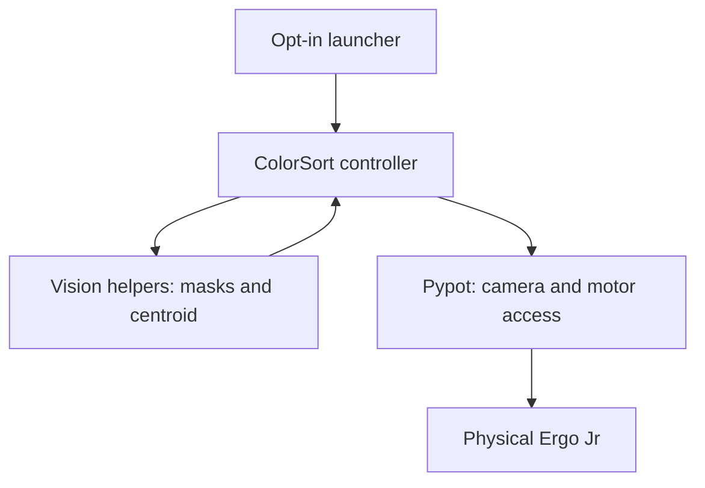

# Poppy Ergo Jr · Vision-based Color Sorting

A student robotics project that uses a Poppy Ergo Jr camera, OpenCV color detection, and a six-motor arm to sort red and blue objects into separate locations.

**Python · OpenCV · Raspberry Pi · Pypot**

## What it does

1. Captures a frame from the robot camera and converts RGB to HSV.
2. Finds red and blue contours and calculates the largest contour's centroid.
3. Maps the horizontal image coordinate to the base motor angle.
4. Lowers the gripper, checks motor load, and lifts the object.
5. Releases red objects to the left and blue objects to the right.

Red takes priority when both colors are visible. This is an educational prototype with fixed poses and timing, not a general-purpose pick-and-place controller.

## Hardware and software requirements

The upstream [Poppy Ergo Jr](https://github.com/poppy-project/poppy-ergo-jr)
is a six-degree-of-freedom educational arm using Dynamixel XL-320 motors and a
Raspberry Pi. This application needs the assembled arm, gripper, working camera,
compatible robot image, power supply, microSD card and local network access.
Use the upstream bill of materials and initialization procedures; this repository
does not supply hardware firmware or motor calibration.

The runtime uses Python 3, `pypot`, `poppy-ergo-jr`, NumPy, OpenCV and matplotlib.
The exact hardware-tested versions are not recorded. A usable display backend
is needed for the current plotting step. Offline checks use a separate environment.

## Getting started

**Start with [Hardware and OS setup](docs/SETUP.md)** for the official image download, flashing instructions, robot initialization, and Python environment checks.

On the robot, using its configured Python environment:

```bash
git clone https://github.com/filip-labs/PoppyErgoJr.git
cd PoppyErgoJr
python3 scripts/check_environment.py
python3 scripts/run_color_sort.py --help
```

After reviewing the calibration notes and clearing the workspace:

```bash
python3 scripts/run_color_sort.py --execute
```

The launcher requires explicit opt-in before running the original motion code. It does not implement an emergency stop or validate physical calibration. The original `python3 ColorSort` entry point remains available and starts the robot immediately.

See [Robot control and shutdown limitations](docs/robot-control.md) before execution.

## Architecture

`ColorSort` owns hardware initialization and the sorting loop. `poppy_sort.vision`
contains image-only functions with no robot imports. Pypot handles access to the
installed robot configuration; no custom communication protocol is implemented.



## Demo

[Watch the robot demonstration](https://www.filipzcvetkovic.com/videos/poppy-ergo-jr.mp4)
(video hosted on the portfolio). The portfolio's interactive 3D arm is a stylized
illustration, separate from the physical demonstration.

[Filip Cvetković's portfolio](https://www.filipzcvetkovic.com)

## Repository guide

| File | Purpose |
| --- | --- |
| [ColorSort](ColorSort) | Original hardware controller; motion sequence retained |
| [Project presentation](Poppy%20Ergo%20Jr.pdf) | Original Serbian presentation with assembly and demonstration context |
| [Setup guide](docs/SETUP.md) | Hardware, OS, dependencies, and first run |
| [Calibration and troubleshooting](docs/CALIBRATION.md) | Pose assumptions, limitations, and common problems |
| [OS image manifest](docs/os-image.json) | Official image URL and published integrity values |
| [Environment checker](scripts/check_environment.py) | Import checks without robot initialization |
| [Contributing](CONTRIBUTING.md) | How to report problems and propose improvements |

## Tests and automation

[Offline development instructions](docs/development.md) explain environment setup.

```bash
python -m unittest discover -s tests -v
python scripts/validate_repository.py
ruff check .
ruff format --check .
```

GitHub Actions runs these checks on Python 3.9 and 3.12 without Pypot or hardware.
Synthetic-image tests and fake-robot regression tests exercise detection,
routing and launcher behavior. Passing them does not establish physical safety.

## Current limitations

- The horizontal mapping assumes a 640-pixel frame; the vertical centroid is not used for motion.
- Joint angles, speed, sleep durations, and the gripper load threshold are fixed in `ColorSort`.
- The red mask covers HSV hue 0–10 only; it does not cover the other end of the red hue range.
- There is no minimum contour-area filter, so colored background noise can trigger detection.
- `plt.show()` can block until the figure is closed and requires a usable plotting backend.
- The script assumes the camera returns RGB. Confirm this on your installed stack.
- There is no guaranteed cleanup on interruption or failed grasp. See the calibration guide before hardware execution.
- Offline tests cover software behavior with fake hardware; physical operation remains unverified by this update.

## Planned improvements

- Add recorded-camera fixtures to the existing synthetic-image tests.
- Move calibrated poses and HSV thresholds into configuration.
- Add contour filtering and camera-only preview mode.
- Add explicit lifecycle management and failed-grasp handling.
- Record the exact robot image, Python version, and dependency versions used in a verified hardware run.

## Contributing

See [CONTRIBUTING.md](CONTRIBUTING.md) for local checks, review expectations and
hardware-test reporting. The [baseline audit](docs/AUDIT.md) records the scope
and outstanding engineering gaps.

## Credits

The presentation credits **Filip Cvetković, Filip Sikimić, and Petar Peškirović** for the demonstration. The robot platform and its software are developed by the [Poppy Project](https://github.com/poppy-project/poppy-ergo-jr). This repository is an independent student application.

## License status

This repository did not include a license when this documentation was added. A license for the application and presentation remains to be confirmed by their rights holders; public availability alone does not grant general reuse permission. Upstream Poppy components keep their own licenses. See [licensing notes](docs/LICENSING.md).
